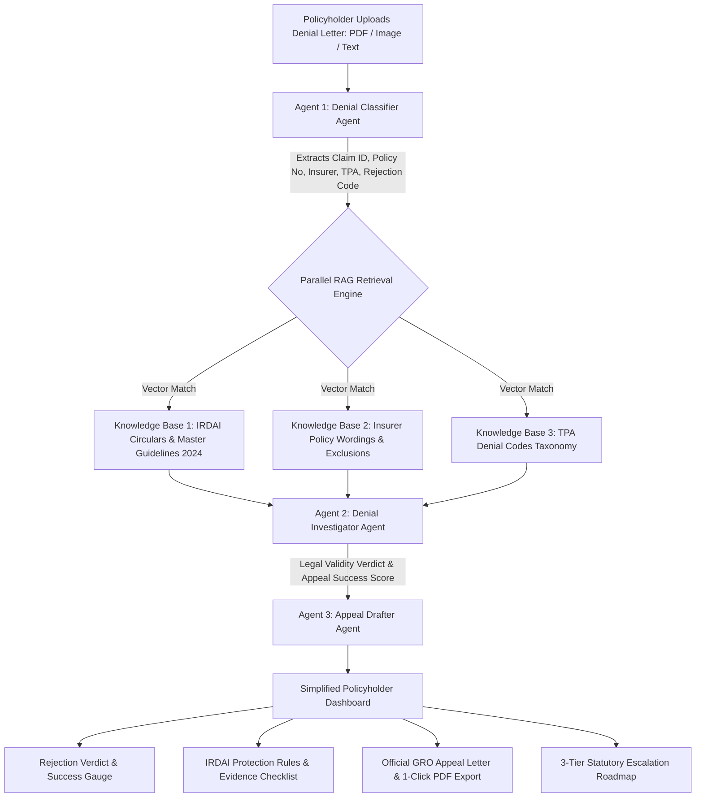

# Product Requirement Document (PRD)

## Project Title
**Agentic RAG-based Health Insurance Claim Denial Analysis and Appeal Assistance System**
*(Health Claim Appeal Assistance Portal / BimaClaimGuard AI)*

---

## 1. Executive Summary & Problem Statement

### 1.1 Executive Summary
Health insurance provides vital financial protection against unexpected medical expenses in India. However, claim denials and repudiations remain a major challenge for policyholders. Rejection notices sent by insurance companies and Third-Party Administrators (TPAs) are frequently filled with technical legal jargon, complex exclusion clauses, and cryptic denial codes (e.g., MDIndia-101, MA-204, V-302) that policyholders struggle to interpret.

The **Agentic RAG Health Insurance Claim Denial Analysis & Appeal Assistance System** is an evidence-based AI platform designed to bridge this information gap. By deploying specialized AI Agents operating over three parallel domain-specific Knowledge Bases (IRDAI Regulations, Insurer Policy Wordings, and TPA Denial Code Taxonomies), the system enables policyholders to instantly understand why a claim was rejected, evaluate whether the rejection is legally valid, and generate a formal, statutory appeal letter formatted for submission to the Insurer's Grievance Redressal Officer (GRO) and the Insurance Ombudsman (Bima Lokpal).

### 1.2 Problem Statement
- **Complexity & Jargon**: Policyholders cannot decipher medical/legal repudiation clauses.
- **Ignorance of Statutory Rights**: Policyholders are unaware of IRDAI Master Circular 2024 mandates (such as the 5-year Moratorium Period rule under Section 61, 1-hour cashless pre-authorization, and mandatory condonation of delayed intimation).
- **Shifted Burden of Proof**: Insurers frequently reject claims for "pre-existing diseases" or "evaluation only" without presenting pre-inception medical evidence.
- **Lack of Structured Appeals**: Most policyholder appeals are rejected because they lack statutory IRDAI citations, policy clause counters, and complete evidence attachment checklists.

---

## 2. Target Audience & Personas

1. **Primary Policyholders & Insured Individuals**: Individuals or family members facing a claim denial, partial sanction, or room rent deduction from Star Health, HDFC ERGO, Care Health, ICICI Lombard, Niva Bupa, etc.
2. **Patient Advocates & Healthcare Consultants**: Professionals assisting patients in drafting legal grievances and Insurance Ombudsman petitions.
3. **Hospital TPA Desk Executives**: Hospital staff helping admitted patients contest pre-authorization denials.

---

## 3. Product Goals & Core Objectives

| Objective | Target Metric / Outcome |
| :--- | :--- |
| **Instant Denial Interpretation** | Translate cryptic TPA denial codes into plain language within 5 seconds. |
| **Parallel Vector RAG Match** | Match denial details against IRDAI Circulars 2024, Policy Wordings, and TPA Taxonomies. |
| **Statutory Appeal Generation** | Automatically generate formal GRO appeal letters complete with statutory citations. |
| **Client-Side PDF Export** | Generate high-resolution, printable PDF appeal letters with 1 click. |
| **Clear Escalation Pathway** | Provide a structured 3-stage roadmap (GRO → IRDAI Bima Bharosa Portal → Insurance Ombudsman). |

---

## 4. Multi-Agent RAG System Architecture

### 4.1 Agent Roles & Responsibilities

#### **Agent 1: Denial Classifier Agent**
- Parses document text (PDF/Image OCR simulation or pasted text).
- Extracts key entities: Claim ID, Policy Number, Insurer Name, TPA Name, Hospital Name, Claimed Amount, Admission/Discharge Dates, Diagnosis, and Denial Code.
- Categorizes the primary rejection vector (Pre-Existing Disease non-disclosure, Lack of Active Treatment, Delayed Intimation, Room Rent Capping, Modern Procedure Exclusion).

#### **Parallel RAG Engine (3 Knowledge Stores)**
- **Store 1: IRDAI Regulations & Circulars**: Contains IRDAI Master Circular 2024 (Section 61 5-Year Moratorium Period rule), Cashless approval timelines (1-hr pre-auth, 3-hr discharge), 30-day claim settlement rule, Delayed intimation condonation circular (IRDAI/HLT/MISC/CIR/216/09/2011), and Insurance Ombudsman Rules 2023 (Rule 13 & Rule 17).
- **Store 2: Insurer Policy Wordings**: Standard policy wording clauses for Star Health Comprehensive, HDFC ERGO Optima Secure, Care Health Care Advantage, ICICI Lombard Health Shield, and Niva Bupa.
- **Store 3: TPA Denial Code Taxonomy**: Code mappings for MDIndia, Medi Assist, Paramount, Vidal Health, and Heritage TPA detailing raw rejection reasons and counter-strategies.

#### **Agent 2: Denial Investigator Agent**
- Evaluates statutory validity (*Invalid/Illegal Repudiation*, *Misapplied Exclusion*, or *Unjustified Technical Delay*).
- Calculates the dynamic **Appeal Win Chance Score** (e.g. 92% High Probability).
- Synthesizes statutory IRDAI legal counters and compiles required supporting medical evidence checklists.

#### **Agent 3: Appeal Drafter Agent**
- Compiles the formal legal representation letter addressed to the Insurer's Grievance Redressal Officer (GRO).
- Formats statutory IRDAI citations, policy wording counters, timeline logs, and attachment checklists.
- Prepares the 3-stage escalation roadmap (Stage 1 GRO Appeal → Stage 2 IRDAI Bima Bharosa Portal → Stage 3 Insurance Ombudsman arbitration).

---

## 5. Feature Requirements & Functional Modules

### 5.1 Document Upload & Sample Selector Module
- Supports drag & drop file upload (PDF/PNG/JPG/TXT) and text pasting.
- Features **4 Pre-Loaded Preset Rejection Cases** for instant 1-click evaluation:
  1. *Star Health - Pre-Existing Condition Non-Disclosure (MDIndia-101)*
  2. *Care Health / Medi Assist - Evaluation & Diagnostic Only Admission (MA-204)*
  3. *ICICI Lombard / Paramount - Delayed Claim Intimation (P-108)*
  4. *HDFC ERGO / Vidal Health - Room Rent Capping & Proportionate Deductions (V-302)*

### 5.2 Denial Analysis Dashboard Module
- Displays Rejection Verdict Badge (*INVALID REPUDIATION - High Chance of Successful Appeal*).
- Features dynamic **Appeal Win Probability Gauge** (0% - 100%).
- Presents **IRDAI Rules Protecting Your Claim** in bullet points.
- Highlights **Required Documents Checklist** for the appeal.

### 5.3 Appeal Letter Workspace Module
- Live editable textarea rendering the generated statutory appeal letter.
- **Download Official PDF Appeal**: Generates a clean, printable PDF using `jspdf` complete with metadata boxes and page numbering.
- **Copy Text**: One-click clipboard copy.

### 5.4 Statutory Escalation Roadmap Module
- **Step 1 (Days 1–15)**: Internal Grievance Redressal Officer (GRO) Appeal.
- **Step 2 (Day 16 Onward)**: IRDAI Bima Bharosa Portal complaint registration (`bimabharosa.irdai.gov.in`).
- **Step 3 (Day 30 Onward)**: Insurance Ombudsman (Bima Lokpal) petition under Rule 13(1) (`cioins.co.in/Ombudsman`).

---

## 6. Technical Stack & Dependencies

| Component | Technology |
| :--- | :--- |
| **Frontend Framework** | React 18 + Vite |
| **Styling System** | Tailwind CSS v4 + Custom Royal Navy Healthcare Theme |
| **Iconography** | Lucide React Icons (`lucide-react`) |
| **PDF Generation** | `jspdf` (Client-side rendering) |
| **Animations & FX** | `canvas-confetti` + Tailwind CSS Transitions |
| **Data Engine** | Embedded Knowledge Base Modules (JSON/JS) |

---

## 7. Key Statutory & Regulatory References

1. **IRDAI Master Circular on Protection of Policyholders' Interests 2024**: Ref IRDAI/HDD/CIR/MISC/093/05/2024.
   - *Clause 61*: Moratorium Period (Incontestability after 5 years of continuous coverage).
   - *Clause 14/15*: Cashless 1-hour pre-authorization & 3-hour final discharge timeline.
2. **IRDAI Circular on Rejection of Claims due to Delay in Intimation**: Ref IRDAI/HLT/MISC/CIR/216/09/2011.
   - Prohibits claim rejection on technical grounds of delayed notice for genuine emergencies.
3. **Insurance Ombudsman Rules, 2017 (Amended 2023)**:
   - *Rule 13(1)*: Jurisdiction up to ₹50 Lakhs.
   - *Rule 17*: Ombudsman awards binding on insurer within 30 days of policyholder acceptance.
4. **IRDAI Guidelines on Standardization of Health Insurance Exclusions 2019**: Ref IRDAI/HLT/REG/CIR/177/09/2019.

---

## 8. Success Metrics (KPIs)

- **Appeal Generation Time**: Under 60 seconds from upload to downloadable PDF.
- **Statutory Citation Match Accuracy**: 100% compliance with IRDAI Master Circular 2024.
- **User Satisfaction & Usability**: Clean single-page workflow designed for non-technical policyholders.
